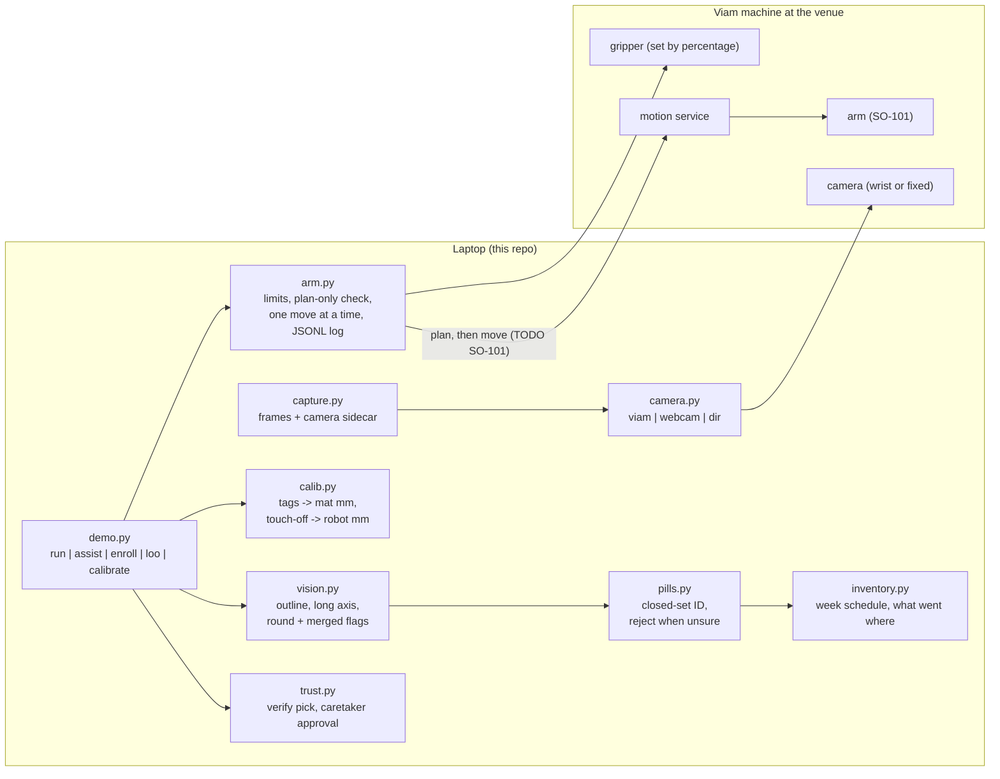
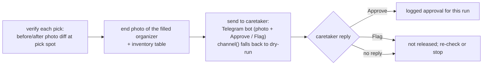

# How Doseday works: control logic and fallbacks

Each move is one step at a time, with a plan-only check before it, and every commanded pose is logged.
Taught poses are used in place of guessed ones.
"Built" means present in this repo with tests. "Planned" means not built. Nothing here has run on an arm yet.

## 1. The pieces

## 2. One pill, start to finish (built, untested on hardware)

1. Move to the photo pose (eye-in-hand only). Refuse if the arm is more than 1 mm from it.
2. Take a frame. Detect blobs, skip merged blobs, classify (reject when unsure), and pick a slot from the schedule.
3. Convert pixels to robot xy. Convert the long axis to a wrist yaw. A round pill keeps the current yaw.
4. `pick`: open the gripper, hover 40 mm (the wrist rotates only in the air), descend straight to 1.5 mm above
   the mat (the floor guard refuses anything lower), set the gripper to the closed percentage, lift straight.
5. `drop`: move over the slot funnel and open the gripper. Only xyz from the saved pose is trusted.
6. Record the placement, then re-photograph before the next pill. Picked pills leave the image.

## 3. Safety gates (each refuses rather than guesses)

| Gate | Where | Refuses when |
|---|---|---|
| Image provenance | `provenance.require` | the image has no capture sidecar (phone photo) |
| Same camera | `provenance.same_camera` | pills were enrolled on a different camera than the run |
| Calibration | `calib.build` | tag or touch residual over 3 mm; mat-only calibration used for live picking |
| Photo pose | live loop | arm more than 1 mm off the taught photo pose |
| Workspace | `PillArm.check` | target outside the x/y box, above z_max, or below the floor |
| Plan | `PillArm.move` | the planner returns no complete path |
| ID | `Registry.classify` | farther than the spread limit from every type, or two types too close to call |
| Blob | `vision.detect` | blob over 1.6 times the median pill area (touching pills) |

## 4. Rig variants and the fallback ladder

| Plan | Needs | What runs | Demo claim |
|---|---|---|---|
| **A** eye-in-hand | arm, wrist camera, gripper | full loop, `capture --arm-photo-pose` | arm sorts, aligns, verifies |
| **B** fixed camera | arm and any camera on a stand | full loop; calibration fixed to the stand | same as A |
| **C** taught tray (planned) | arm, gripper | taught poses per tray cell; vision only for ID and verify | arm fills the week from a known tray |
| **D** dose cups (planned) | arm, gripper that fails T5 | move whole pre-filled cups | arm delivers each cup; vision IDs them |
| **E** no arm | any camera | `demo.py assist`: the screen labels each pill with its slot; a person places it | same planner, human hands; approval loop still works |

## 5. Trust and approval loop

- `verify_pick` runs in the live loop after each pick.
- `Recorder` (video of a run) is tested but not called from the loop yet.
- Approval is a logged decision, not a physical lock.
- Planned, not built: an SMS channel. Any SMS link to a photo needs access control first.
- Planned, not built: an audible or spoken announcement before each move. `trust.announce` has no caller.

## 6. Teleop to automation

Teach poses by hand (`arm.py teach photo | touch-N | Mon-AM ... | reject`), replay the taught poses for drops,
and let vision decide only which pill it is and where it lies. Every run leaves a JSONL log of commanded poses,
so a failed run can be explained from the log.
