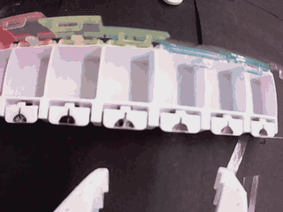
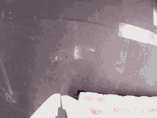
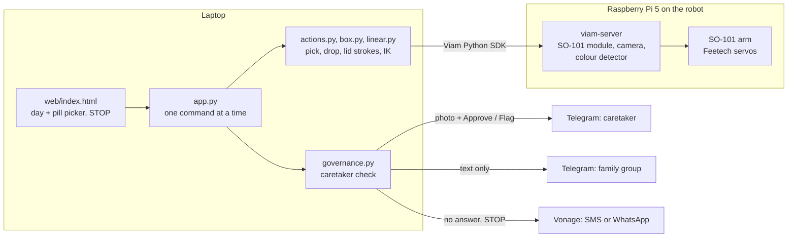

# Doseday

**A robot arm that fills your weekly pill organizer and snaps the lids shut, while a caretaker approves every fill from their phone.**

Built in two days at the Spooky Civic AI Hackathon (NYC, 23-24 Oct 2026), Viam Physical AI track, by Alex Wu, Sammy Suliman and Alan Wu.

<p>
  
  
</p>

*The robot's own wrist camera, unedited. Left: three tablets picked and dropped into Sunday, Tuesday and Friday, each on the first grab (8x speed). Right: Monday's lid folded and pressed shut (3x).*

## Why

Four in ten adults over 65 take five or more prescription drugs. One in four older Medicare patients on blood pressure medicine doesn't take it as prescribed. People with low vision are two to three times more likely to need someone else to manage their pills. That someone is usually family, often from far away.

Pharmacies and factories already sort pills with robots. Doseday brings that into the home, sized for one kitchen table, and keeps the family in control of it.

## What it does

1. **You pick the day and the pill** on a large-print, high-contrast screen built for low vision.
2. **The arm reaches, grips, and checks the grip.** The gripper reports how far its jaw closed. If it closed on nothing, the arm searches around the spot, retries, and saves the correction for the next run.
3. **It drops the pill into that day**, then closes the lid. It pushes from far out along the lid for leverage, then presses until it clicks.
4. **A caretaker signs off.** A photo of the organizer goes to the caretaker on Telegram with Approve and Flag buttons. Nothing counts as done until they approve it.
5. **Nobody is left guessing.** No answer means Vonage texts the caretaker's phone. A flag pauses the arm. The family group chat hears what happened, in words only: nobody but the caretaker sees anyone's medicine.
6. **STOP always wins.** One button cancels the running move, stops the arm and clears the queue. Every move and every decision is logged.

## Proven on the robot (24 Oct)

| | Result | Evidence |
|---|---|---|
| Pick and drop | **3 of 3 tablets, each on the first grab** (red to Sunday, peach to Tuesday, cream to Friday) | `runs/2026-10-24-robot-run-1558`, filmed |
| Grip check | jaw read 8.9% closed on each held tablet; an empty grab reads under 2% | same run |
| Lids | **Monday, Tuesday and Wednesday closed by the arm** | `docs/DAY2-FINDINGS.md` |
| Caretaker check | Approve, Flag, no-answer escalation and STOP alerts | 235 tests, `docs/GOVERNANCE.md` |

Picks replay a path taught once by hand, with the grip check and search on top. Next up: capsules, the pale-blue tablet that the gripper still drops, and Thursday to Saturday lids.

## How it works



- **Motion:** our own inverse kinematics on the servo-calibrated joint limits (`linear.py`), straight-line claw moves, waypoints sent in chunks of 60, and torque capped for lid presses. The box's position comes from two claw touches (`box.py mark mon`, `mark fri`), and every lid and drop position follows from those.
- **Teaching:** move the arm by hand in manual mode or mirror the black leader arm, record joints, jaw and wrist video together (`record_teleop.py`, `scripts/record_demo.py`), label the segments, replay them with grip checks (`scripts/replay_run.py`).
- **Safety in code:** every path is checked against the servo limits before anything moves, the claw stays above the standing lids between moves, one command runs at a time, and a flagged fill refuses the next placement.

## Tech stack

| | |
|---|---|
| **Robot** | SO-101 arm (Feetech servos), Raspberry Pi 5, wrist camera |
| **[Viam](https://viam.com)** | viam-server on the Pi, `devrel:so101-arm` module, arm, gripper and camera components, leader-follower teleop, built-in colour detector, Python SDK over the cloud |
| **[Vonage](https://vonage.com)** | SMS API for caretaker escalation and STOP alerts; Messages API sandbox (WhatsApp) for demos |
| **Telegram Bot API** | caretaker photo with Approve and Flag buttons; text-only family group |
| **Vision** | OpenCV and NumPy pill features; optional Claude vision for pill ID (`app.py --claude`); YOLOv8s pill detector shown on the laptop (`models/`) |
| **App** | Python standard-library HTTP server, one HTML page, no build step |
| **Built with** | Python, pytest (235 tests), Claude Code |

## Try it

No robot needed:

```
python3 -m venv .venv
.venv/bin/pip install -r requirements.txt
.venv/bin/python -B -m pytest -q
.venv/bin/python app.py --fake        # open http://localhost:8000
```

Tap a day, tap a pill, press STOP. With no keys set, the caretaker card runs in demo mode and every notice is logged as a dry run.

**Live caretaker notices:** put `VONAGE_API_KEY`, `VONAGE_API_SECRET` and `CARETAKER_PHONE` in `.env` (plus `VONAGE_FROM` for SMS, or `VONAGE_CHANNEL=whatsapp` for the sandbox), then `python notify.py test` sends one message to your phone. `DOSEDAY_APPROVAL_TIMEOUT_S=20` makes the no-answer text arrive 20 seconds after a fill instead of 10 minutes.

**On the robot:** `python app.py` connects to the Viam machine using the keys in `.env`. Rebuilding the table: [`docs/VENUE-SETUP.md`](docs/VENUE-SETUP.md).

## Repo map

| Path | What's there |
|---|---|
| `app.py`, `web/` | the control page and its server |
| `actions.py`, `box.py`, `linear.py`, `arm.py`, `armctl.py` | arm moves, box registration, kinematics, hand-guided mode and taught poses |
| `governance.py`, `trust.py`, `notify.py` | caretaker approval, family and Vonage notices |
| `vision.py`, `pills.py`, `identify.py`, `identify_claude.py`, `camera.py`, `calib.py` | pill detection and identification |
| `demo.py`, `sim.py`, `fakes.py` | the full sort loop, a simulated arm, offline fakes |
| `scripts/` | hardware runs: replay a taught run, close lids, record demos |
| `runs/` | every recorded run: joints, jaw, labels ([`runs/DATASET.md`](runs/DATASET.md)) |
| `tools/` | one-off diagnostics and `checkpoint.sh` |
| `tests/` | offline tests; nothing touches the network or the arm |
| `docs/` | findings, setup, governance, control logic, camera |

## Docs

| File | Read it for |
|---|---|
| [`docs/DAY2-FINDINGS.md`](docs/DAY2-FINDINGS.md) | what worked on the robot and how |
| [`docs/GOVERNANCE.md`](docs/GOVERNANCE.md) | caretaker approval, family and Vonage notices, what pauses the arm |
| [`docs/HARDWARE-SETUP.md`](docs/HARDWARE-SETUP.md) | table layout, wiring, photos |
| [`docs/CONTROL.md`](docs/CONTROL.md) | control logic, safety gates, fallback plans |
| [`docs/CAMERA.md`](docs/CAMERA.md) | the vision service and camera exposure at boot |
| [`docs/ONBOARDING.md`](docs/ONBOARDING.md) | setup and repo tour |
| [`docs/TESTS.md`](docs/TESTS.md) | the numbered hardware tests |
| `AGENTS.md` | rules for changing the code |

## Safety and secrets

The demo uses candy, Tums and vitamins only. Nothing here is medical advice, and the code is not validated for handling medication.

Credentials come from the environment or a gitignored `.env`. `poses.json`, `calib.json`, `pills.json` and `.env*` are site data and are never committed.
