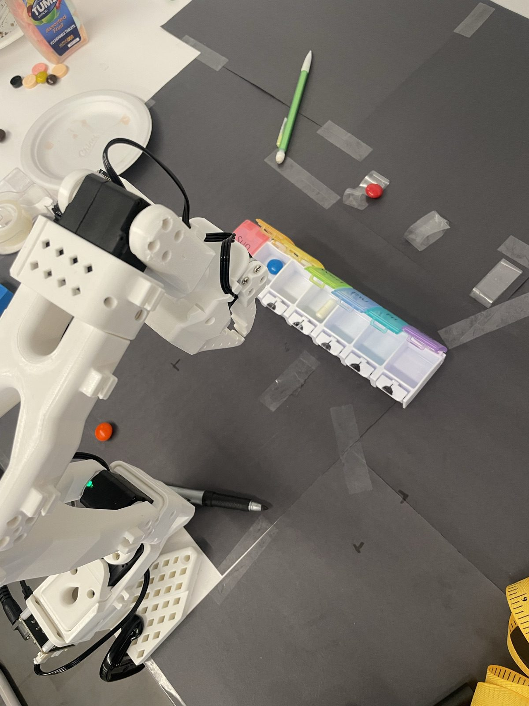
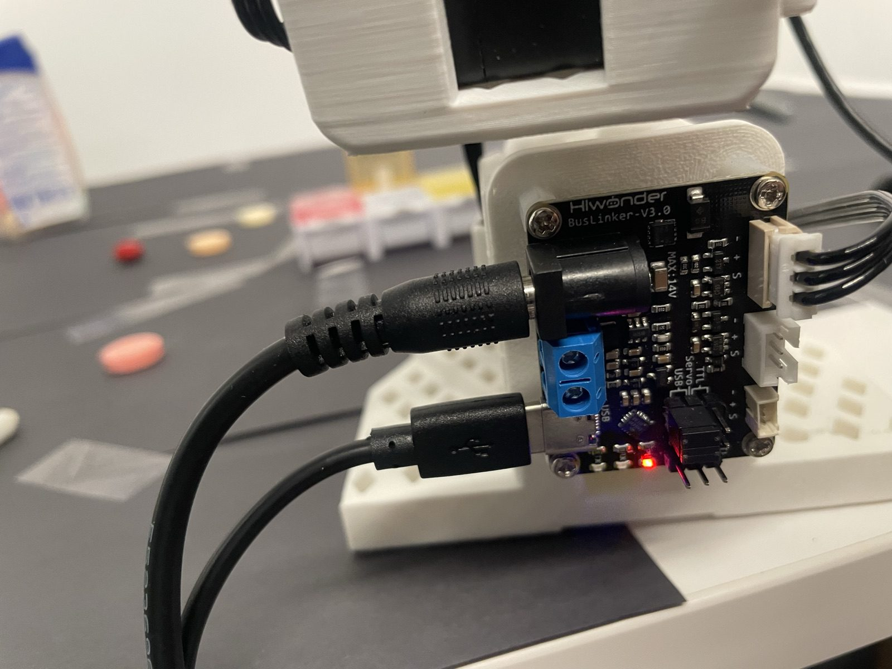

# Hardware and table setup, as packed (23 Oct 2026)

How to rebuild the Doseday table at a new venue: where everything sat, what plugs into what, and the photos taken at pack-up. Each number says where it came from:

- **arm-measured:** from the arm's own kinematics and the box fitted to Alex's run-04 lid presses (`box.demo_box()`); millimetre-level
- **tape:** read off the photos; good to about ±1 cm

The two-touch registration (`box.py mark mon`, `mark fri`, `fit`) measures the box wherever it lands. Use these numbers to put things back close to where the recordings and the tray pick were made.

## Layout

- **Arm:** the white follower arm is clamped at the table's front edge and faces away from you. Its turntable axis sat about 5 cm in from the edge (inferred from the tape reading and the arm's numbers below).
- **Pillbox:**
  - latch tabs (the front edge) face the arm
  - Sunday is on the arm's left, Saturday on its right, Wednesday straight ahead
  - both ends are held down with clear tape; Sunday and Saturday stay shut and the robot never touches them
- **Black paper:** 12 in sheets taped together and to the table. The sheet beside the base starts flush against the base plate and runs 12 in along the table edge (photo 03). The day 1 pen marks (⊥) are on the paper, so they travel with it.
- **Pills:** the Tums tub and the candy sat on white paper at the back left, off the black paper.

### Positions (arm-measured)

Millimetres in the arm's base frame: x forward, y to the arm's left, z up.

- The base frame's origin is 38.8 mm behind the turntable axis (from the arm's kinematic model).
- Lids are 32.7 mm apart; the closed lid tops are at z = 28 mm.

| Spot | x | y | From the turntable axis |
|---|---|---|---|
| Sunday, front-edge centre | 232.6 | 97.5 | 217 mm, 27° left |
| Monday | 236.2 | 65.0 | 208 mm, 18° left |
| Tuesday | 239.8 | 32.5 | 204 mm, 9° left |
| **Wednesday** | 243.3 | 0.0 | **204.5 mm, straight ahead** |
| Thursday | 246.9 | −32.5 | 211 mm, 9° right |
| Friday | 250.4 | −65.0 | 221 mm, 17° right |
| Saturday | 254.0 | −97.5 | 236 mm, 24° right |
| Tums pick spot (run 06; `TRAY` in `scripts/trial_pick.py`) | 346.3 | −108.1 | 326 mm, 19° right; grasp at z 10.6 |
| Drop over Friday (`DROP` in `scripts/trial_pick.py`) | 247.1 | −67.6 | 219 mm, 18° right; z 31 |

The box sat 6.2° off square: the Saturday end was about 2 cm farther from the arm than the Sunday end. There is no need to copy the angle, because registration measures it.

### Tape readings

The yellow tape's first 2.8 in are cut off, so subtract 2.8 in from every reading.

| Photo | From and to | Reading | Distance |
|---|---|---|---|
| 02 | Sunday end's front corner to the table's front edge, straight toward you | 12.2 in | **9.4 in (24 cm)** |
| 03 | Base plate to the far end of the black sheet, along the table edge | 14.7 in | **11.9 in (one 12 in sheet)** |
| 04 | Saturday end's front corner, along the box line | far end out of frame | not recorded |

**Cross-check:** the arm puts the Sunday corner 192 mm in front of the turntable axis. With the 24 cm tape reading, the axis sits about 5 cm from the table edge (inferred, ±2 cm).

## Wiring

| Part | Power | Data | Settings |
|---|---|---|---|
| Follower (white): Hiwonder BusLinker V3.0 on its base | DC barrel jack (board takes 14 V max) | USB-C to the hub | Servo chain in the **top** 3-pin socket (− + S). Jumper on the two pins next to **USB** (USB–Servo), not TTL. |
| Leader (black): same board | DC barrel jack | USB-C to the hub | Same socket and jumper. Torque stays off except during teleop. |
| USB hub (black, 4 ports) | from the Pi | its cable goes to the Pi | 3 plugs; the leftmost port is empty (photo 06) |
| Raspberry Pi 5, 4 GB, in a black case base (no lid); runs viam-server as `pi-arm1` | white USB-C cable into the power port | hub cable in the **lower blue USB 3** port | Ethernet, HDMI and the other three USB ports are empty (photo 08) |

- **What's in the hub (inferred):**
  - two of the plugs are the same small type as the boards' USB-C cables, so they are probably the two arms
  - the third, standard plug is probably the camera
  - nothing else was in the Pi, so three USB devices were connected at pack-up
- **Not photographed:** the arm clamp, the lamp, the power bricks and the camera cables.
- **Power bricks:** read each brick's output voltage before plugging in; the boards take 14 V at most. If the two bricks differ, ask Nick which arm takes which.
- **Port names:** on day 1 a re-plug moved the leader from ttyACM0 to ttyACM2 and broke the config.
  - After plugging in, run `ls -l /dev/serial/by-id/` on the Pi to see which ttyACM is which board.
  - The config should use those by-id paths; ask Nick to set them.
- **Jumper knocked off in transport:** the red PWR LED still lights, but the servos won't answer. Put the jumper back on the USB–Servo pins.

## Photos

| File | What it shows |
|---|---|
| `01-overview.jpg` | The table from above: arm, pillbox, taped ends, paper seams and pen marks |
| `02-sun-corner-to-table-edge.jpg` | Tape from the Sunday corner to the table edge |
| `03-sheet-beside-base.jpg` | Tape along the table edge from the base plate; the black sheet is 12 in |
| `04-sat-corner.jpg` | Tape starting at the Saturday corner (far end out of frame) |
| `05-leader-board.jpg` | The leader's BusLinker: barrel power, USB-C, servo socket, jumper |
| `06-usb-hub.jpg` | The hub with 3 of 4 ports used |
| `07-follower-board.jpg` | The follower's BusLinker, wired the same way |
| `08-pi-on-table.jpg` | The Pi 5 with its power and hub cables |
| `09-pi-board.jpg` | The Pi 5 board; the memory strap is on 4G |
