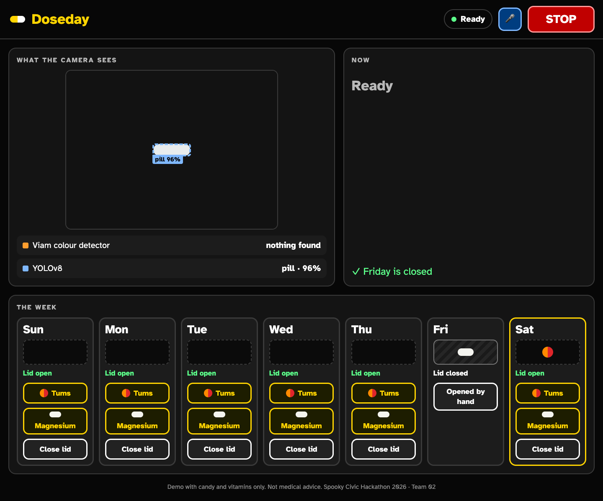
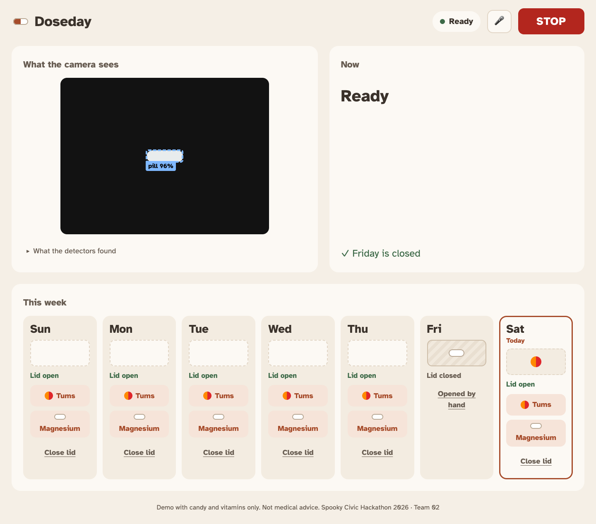
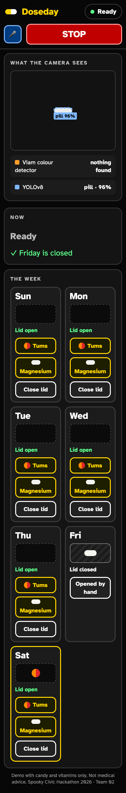
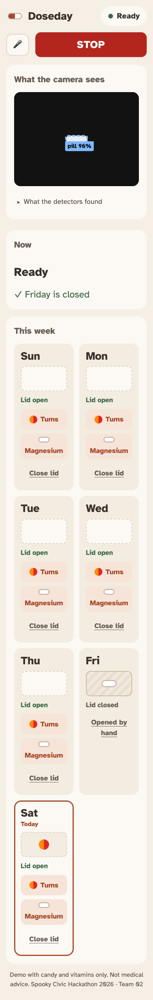

# Warmer dashboard (branch `alex/ui-warm`)

Built on `ui/demo-dashboard` (cadf829). Only `web/index.html` changed; no backend, API or robot code.

| Before | After |
|---|---|
|  |  |
|  |  |

`after-open.png` shows the detector list opened.

- Palette: beige background `#F5EFE6`, cream cards `#FCF9F4` / `#F3ECE1`, text `#3A322B`, secondary `#685D52`,
  one terracotta accent `#A64B2A` (tint `#F6E4D9`), status sage `#3D6A48` and brick `#A3362A`; STOP stays `#B3261E`.
- Contrast: every text pair passes WCAG AA; lowest 4.65:1 (accent on its tint), body text 10.7-12:1.
- Calmer: 21 px text with 1.5 line height, no card borders or uppercase headings, "Today" marked on the current day,
  the detector list behind a "What the detectors found" toggle (boxes still drawn on the camera frame).
- Not yet checked against the live camera image (the fake camera frame is black).
